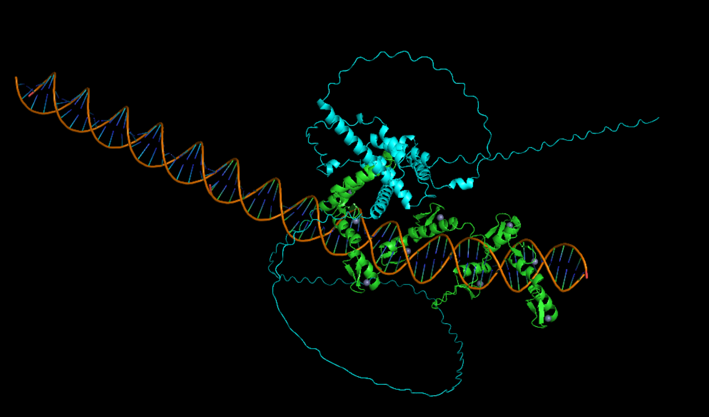
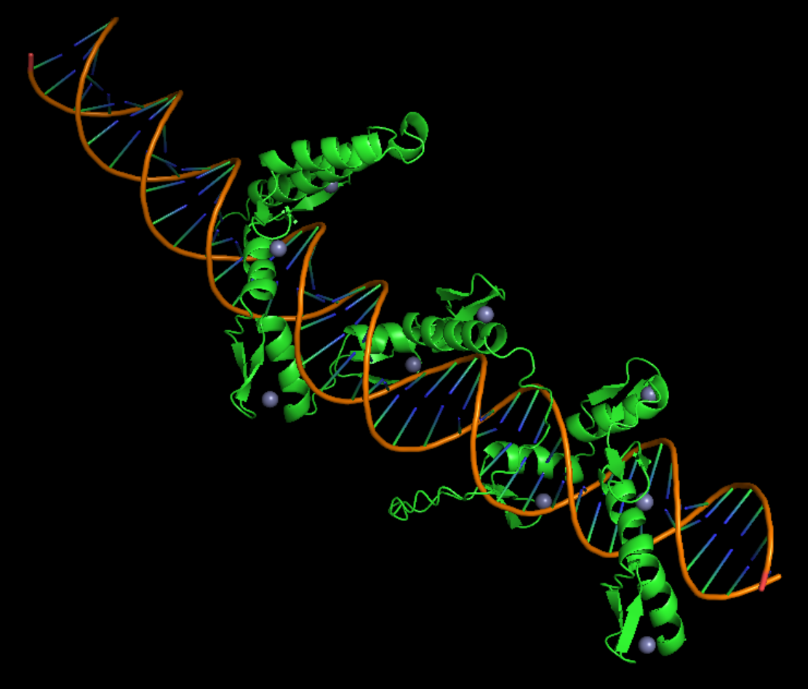
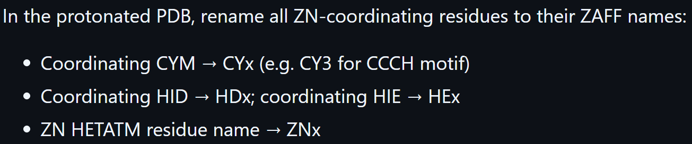
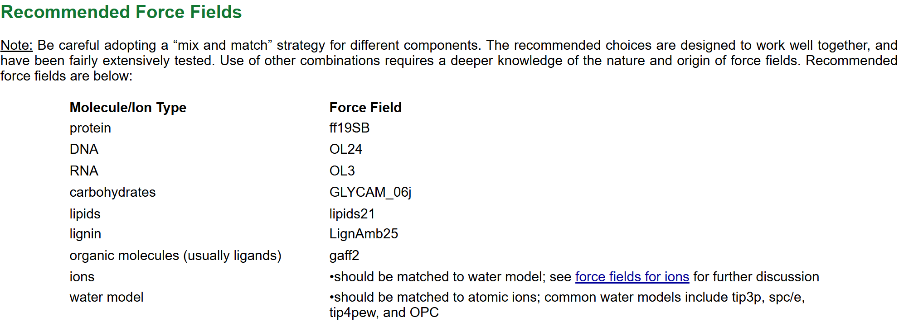
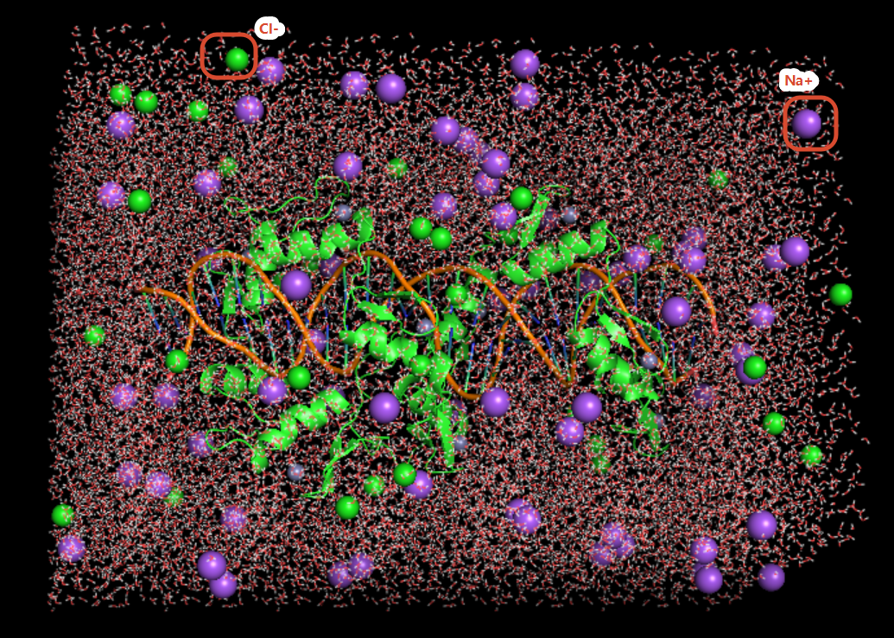

# 🔬 PDB/MMCIF toolkit in Molecular Dynamic Simulation workflows

> [!WARNING]
> Formerly published on PyPI as `pdb-select`. That name is deprecated — use `pdb-md`.

> Pre- and post-processing toolkit for PDB/MMCIF structure files in molecular dynamics workflows.  

# Prerequisites

> Always check for the forums of the MD simulation software you are using.

|Tool| Description | Url |
|--|--|--|
|Amber| Amber Mailing List Archive |http://archive.ambermd.org/ <br><br> https://cse.google.com/cse?cx=partner-pub-9700140137778662:8927431201&ie=UTF-8&sa=Search&ref=lists.ambermd.org/ |
|Gromacs|GROMACS community forums | https://gromacs.bioexcel.eu/ |
|| 计算化学公社- 高水平计算化学、理论化学交流论坛[`CHINESE`]  | http://bbs.keinsci.com/forum.php |

# Installation

```bash
pip install pdb-md
```

# Usage

```bash
❯ pdb-md --help
                                                                                                                                                    
 Usage: pdb-md [OPTIONS] COMMAND [ARGS]...                                                                                                          
                                                                                                                                                    
 Pre- and post-processing toolkit for PDB/MMCIF structure files in molecular dynamics workflows.                                                    
                                                                                                                                                    
╭─ Options ────────────────────────────────────────────────────────────────────────────────────────────────────────────────────────────────────────╮
│ --install-completion          Install completion for the current shell.                                                                          │
│ --show-completion             Show completion for the current shell, to copy it or customize the installation.                                   │
│ --help                        Show this message and exit.                                                                                        │
╰──────────────────────────────────────────────────────────────────────────────────────────────────────────────────────────────────────────────────╯
╭─ Commands ───────────────────────────────────────────────────────────────────────────────────────────────────────────────────────────────────────╮
│ select        Select segments from a PDB or MMCIF structure file.                                                                                │
│ termini-rm5p  Remove terminal phosphate groups from nucleic acids, e.g. 5' phosphate group from DNA/RNA.                                         │
│ res-rename    Rename residues of specified chains and residue numbers, e.g. to the residue names a                                               │
│               force field expects for a given protonation state (HIS -> HIE/HID/HIP, CYS -> CYM).                                                │
│ neighbor      Find all atoms within a distance of a given atom (identified by its serial number).                                                │
│ restrain      Generate heavy-atom position-restraint .itp files for the given moleculetypes                                                      │
│               and write a patched copy of the topology that includes them.                                                                       │
╰──────────────────────────────────────────────────────────────────────────────────────────────────────────────────────────────────────────────────╯

                                                               
```

## 0️⃣ prepare initial structure for your system

> For monomer modeling, take protein CTCF as an example.

- If an experimental structure such as a PDB entry is available, directly download the experimental structure.
- If no experimental structure is available:
  - Homology modeling: Common homology modeling tools include Swiss-Model, Modeller, I-TASSER, etc. `The uniprot-structure entry usually provides links to existing homology modeling structure databases`, which generally point to the Swiss-Model database.
  - Prediction: Use SOTA prediction tools such as alphafold3.
  - Prediction database: The AlphafoldDB database contains predicted structures of many proteins, which can be downloaded directly.

> For complex modeling, such as the CTCF-DNA complex

- Molecular docking: The monomer structures of the protein and DNA can be obtained via the above methods, and then molecular docking tools are used for complex modeling, such as HADDOCK, ZDOCK, HDOCK, etc.
- Homology modeling: When performing homology modeling for proteins, the template may contain complex information (for example, when searching for homologous templates of CTCF, we may find existing crystal structures of homologous proteins bound to DNA sequences). In such cases, homology modeling tools can be directly used for complex modeling.
- Complex structure prediction: Use SOTA complex structure prediction tools such as alphafold3.

One issue to note: unreasonable parts in the obtained structure can generally be corrected in the subsequent simulated energy minimization stage in most cases.

|Description|Url|
|--|--|
|Homology Modeling|https://strbio.github.io/homology.html  <br> https://strbio.github.io/advanced.html|
|Modeling Resources|https://strbio.github.io/links.html|

> However, `Given the inherent sampling limitations of standard molecular dynamics simulations and their pronounced dependence on initial configurations, what fundamental insights or predictive value can be reliably derived from such localized trajectories?`
>
> `How can we ensure the scientific rigor of structural interpretations derived from limited sampling, and prevent molecular simulations from merely becoming post hoc rationalizations of predetermined initial structures?`
>
> If you are puzzled by these questions, and specifically on meaning of `Initial Structure and Sampling in Molecular Dynamics`, you can refer to [meaning of MD](./refers/meaning_of_md.md)

## 1️⃣ select

> [!WARNING] 
> The `segment` range parameter we using is filtered based on `resseq of (hetflag, resseq, icode) tuple output by residue.get_id() in Bio.PDB module of biopython`.
> 
> Resseq from few structures match UniProt. We only perform this test on AlphaFold output files.
> 
> So, we strongly recommend you to check th `SIFTS` mapping file for the structure you are going to use, and make sure the `segment` parameter is correct in Uniprot sequence-level meaning (most case).

`Select segments from a PDB or MMCIF structure file`

```bash
❯ pdb-md select --help
                                                                                                                                                                               
 Usage: pdb-md select [OPTIONS]                                                                                                                                                
                                                                                                                                                                               
 Select segments from a PDB or MMCIF structure file.                                                                                                                           
                                                                                                                                                                               
╭─ Options ───────────────────────────────────────────────────────────────────────────────────────────────────────────────────────────────────────────────────────────────────╮
│ *  --input        -I      <path>  Input PDB or MMCIF file [required]                                                                                                        │
│    --output       -O      <path>  Output PDB file, defaults to <input stem>_selected.pdb in the current working directory                                                   │
│ *  --segment      -S      <str>   Segments to select, either 'chain' (whole chain, e.g. A) or 'chain:start-end' (e.g. A:1-10). Repeatable. The start-end range filters      │
│                                   polymer residues only; HETATM residues on the same chain are gated solely by --keep-hetero.                                               │
│                                   [required]                                                                                                                                │
│    --keep-hetero  -H      <str>   Keep HETATM residues. Repeatable. Each entry is 'spec' where spec is 'none','all', or a comma-separated list of residue names (e.g. 'ZN'  │
│                                   or 'ZN,HOH'). An entry without a colon/chain is the global default for every chain; an entry with a chain (e.g. 'A:all') overrides the    │
│                                   global set for that chain. Entries in the same scope are combined by union (-H ZN -H HOH == -H ZN,HOH); a chain entry replaces, not       │
│                                   merges with, the global set. A chain must also appear in --segment, otherwise it is dropped before -H is consulted.                       │
│    --help                         Show this message and exit.                                                                                                               │
╰─────────────────────────────────────────────────────────────────────────────────────────────────────────────────────────────────────────────────────────────────────────────╯
```

example:

```bash
pdb-md select -I znf263_all_hs7_30_0.54_0.37_model_0.cif -O znf263_all_hs7_30_0.54_0.37_model_0_selected.pdb -S A:369-683 -S B -S C -S D -S E -S F -S G -S H -S I -S J -S K:1-47 -S L:29-75 -H ZN
```

change from 
 to


---

### Selecting HETATM / heterogen residues 

> In short: polymer residue is governed by `range` + `chain` double filter, while HETATM is governed by `chain` only. The `--keep-hetero` option is the only way to keep HETATM residues.

HETATM residues (ions, ligands, waters, sugars) are selected at the **chain** level, not by residue range. The `chain:start-end` syntax filters polymer residues only.

Consequences:

- A chain made entirely of HETATM (e.g. a single Zn ion, a glycan chain) is governed by the chain whitelist alone — `-S B` keeps the whole Zn.
- On a **mixed** chain, `chain:start-end` does NOT narrow which HETATM are kept: `-S A:1-3 --keep-hetero UNX` still keeps `UNX` at resid 109, because the HETATM branch ignores `regions`.
- `--keep-hetero ''` (default) drops every HETATM; `all` keeps them all; a comma list (e.g. `ZN, HOH`) is an exact resname whitelist (case-insensitive).

To pick specific HETATM on a mixed chain, split the chain in preprocessing (e.g. give the heterogen its own chain id) — the current CLI has no per-HETATM range selector.

#### `--keep-hetero` syntax 

`-H` is repeatable. Each entry is `[chain:]spec`:  

| entry | meaning |
|---|---|
| `-H ZN` | global: every chain keeps HETATM named `ZN` | 
| `-H ZN,HOH` | global: every chain keeps `ZN` and `HOH` |  
| `-H all` | global: every chain keeps all HETATM |
| `-H none` / `-H ''` | global: every chain drops all HETATM (default) | 
| `-H A:all` | chain A keeps all of its HETATM | 
| `-H A:none` | chain A drops all of its HETATM |
| `-H E:ZN,HOH` | chain E keeps only `ZN` and `HOH` |

Two rules govern how entries combine:  
1. **Union within the same scope.** Several entries for the same scope add up:
`-H ZN -H HOH` ≡ `-H ZN,HOH`, and `-H E:ZN -H E:HOH` ≡ `-H E:ZN,HOH`.
Adding an entry never removes something already whitelisted.
2. **A chain entry overrides the global entry.** A chain that has its own
`[chain:]` entry uses *only* that set and ignores the global one. This is what
makes per-chain removal expressible: `-H ZN -H J:none` keeps `ZN` everywhere except chain J.

A `-H` chain id must also appear in `--segment`; otherwise the chain is dropped before `-H` is ever consulted, and a warning is printed.

## 2️⃣ preprocessing for MD simulation

Here we summarize several important easy to use application for fixing problems in Protein Data Bank files in preparation for simulating them.

|Tool name|Description|Url| Note |
|--|--|--| --- |
|PDBFixer|PDBFixer is an easy to use application for fixing problems in Protein Data Bank files in preparation for simulating them|https://github.com/openmm/pdbfixer <br><br> https://htmlpreview.github.io/?https://github.com/openmm/pdbfixer/blob/master/Manual.html| General purpose tool for fixing PDB files|
|pdb2gmx|gmx pdb2gmx reads a .pdb (or .gro) file, reads some database files, adds hydrogens to the molecules and generates coordinates in GROMACS (GROMOS), or optionally .pdb, format and a topology in GROMACS format. These files can subsequently be processed to generate a run input file|https://manual.gromacs.org/current/onlinehelp/gmx-pdb2gmx.html| Designed for preparing PDB files for GROMACS simulations, pdb2gmx is a subcommand of GROMACS tool gmx —— `gmx pdb2gmx`, it has several options for pdb file processing like `-ignh` to add the hydrogens, see in `gmx pdb2gmx -h` |
|pdb4amber|Analyse PDB files and clean them for further usage, especially with the LEaP programs of Amber |https://ambermd.org/AmberTools.php | pdb4amber tool from the AmberTools MD package, designed for preparing PDB files for Amber simulations, also a command-line utility in the AmberTools suite —— `pdb4amber`, it also has several options for pdb file processing, Removing hydrogen or water atoms, see `pdb4amber -h`  |
|BioForge|BioForge is a pure-Rust toolkit for automated preparation of biological macromolecules. It reads experimental structures (PDB/mmCIF), reconciles them with high-quality residue templates, repairs missing atoms, assigns hydrogens and termini, builds topologies, and optionally solvates the system with water and ions—all without leaving the Rust type system|https://github.com/TKanX/bio-forge||
|pdbtools|A set of tools for manipulating and doing calculations on wwPDB macromolecule structure files|https://github.com/harmslab/pdbtools| see `File/structure manipulation` part for cleaning function in https://github.com/harmslab/pdbtools#filestructure-manipulation |
|pdb-tools|A dependency-free cross-platform swiss army knife for PDB files|https://github.com/haddocking/pdb-tools|see https://www.bonvinlab.org/pdb-tools/|


### `normal preprocessing`

> cited from pdbfixer manual
```bash
- If the structure was generated by X-ray crystallography, most or all of the hydrogen atoms will usually be missing.
- There may also be missing heavy atoms in flexible regions that could not be clearly resolved from the electron density. This may include anything from a few atoms at the end of a sidechain to entire loops.
- Many PDB files are also missing terminal atoms that should be present at the ends of chains.
- The file may include nonstandard residues that were added for crystallography purposes, but are not present in the naturally occurring molecule you want to simulate.
- The file may include more than what you want to simulate. For example, there may be salts, ligands, or other molecules that were added for experimental purposes. Or the crystallographic unit cell may contain multiple copies of a protein, but you only want to simulate a single copy.
- There may be multiple locations listed for some atoms.
- If you want to simulate the structure in explicit solvent, you will need to add a water box surrounding it.
- For membrane proteins, you may also need to add a lipid membrane.
```

you can
```bash
Add missing heavy atoms.
Add missing hydrogen atoms.
Build missing loops.
Convert non-standard residues to their standard equivalents.
Select a single position for atoms with multiple alternate positions listed.
Delete unwanted chains from the model.
Delete unwanted heterogens.
Build a water box for explicit solvent simulations.

Remove Chains
Identify Missing Residues
Replace Nonstandard Residues
Remove Heterogens
Add Missing Heavy Atoms
Add Missing Hydrogens
Add Water
Add Membrane
```

### `Removal of terminal phosphate group for Nucleic Acid`

> It is usually suggested that while preparing a nucleic acid system for simulation, 5' terminal phosphate group must be removed; or any terminal charged phosphate group should be removed...
>
> Nucleic acids typically do not have 5’-phosphate groups. Force fields are parametrized to the most common use cases and do not necessarily cover all possible chemical space. Delete the phosphate atoms from the 5’-nucleotide and you can generate the topology such that it has a free 5’-hydroxyl group.

> In most cases, e.g. for DNA simulations, 5’-phosphate groups are less cared about, so you can just delete them

Remove any phosphate group from terminal residues; these are often present synthetically but are not how force fields are typically parametrized (5’-OH terminus is typical).

In detail, we just need to remove the **`[O1P/OP1, O2P/OP2, O3P/OP3 if exists, P, Hydrogens attached to them]`** atoms from the 5' terminal residue of a nucleic acid chain.

You can use the `termini-rm5p` command to remove the 5' terminal phosphate group from nucleic acids as talked above.

```bash
❯ pdb-md termini-rm5p --help
                                                                                                                                                                                                          
 Usage: pdb-md termini-rm5p [OPTIONS]                                                                                                                                                                     
                                                                                                                                                                                                          
 Remove terminal phosphate groups from nucleic acids, e.g. 5' phosphate group from DNA/RNA.                                                                                                               
                                                                                                                                                                                                          
╭─ Options ──────────────────────────────────────────────────────────────────────────────────────────────────────────────────────────────────────────────────────────────────────────────────────────────╮
│ *  --input   -I      <path>  Input PDB or MMCIF file [required]                                                                                                                                        │
│    --output  -O      <path>  Output PDB file, defaults to <input stem>_rm5p.pdb in the current working directory                                                                                       │
│    --chain   -C      <str>   Chains to process. Repeatable. If not provided, all chains will be processed.                                                                                             │
│    --help                    Show this message and exit.                                                                                                                                               │
╰────────────────────────────────────────────────────────────────────────────────────────────────────────────────────────────────────────────────────────────────────────────────────────────────────────╯
```

```bash
❯ pdb-md termini-rm5p -I znf263_all_hs7_30_0.54_0.37_model_0_selected.pdb -C K -C L

Wrote znf263_all_hs7_30_0.54_0.37_model_0_selected_rm5p.pdb
  chain K: removed OP3, P, OP1, OP2
  chain L: removed P, OP1, OP2
```


### `protonation(add hydrogens) and residue renaming`

protonation state of the protein is important for MD simulation. The protonation state of a protein can be determined by the pH of the environment, which can affect the charge and conformation of the protein.

Here we summarize several tools for predicting or assigning the protonation state of a protein:

> Basically predicted/assigned based on comparison between Pka calculation and the pH of the environment. 

|Tool name|Description|Url| Note |
|--|--|--| --- |
|H++ |H++ is an automated system that computes pK values of ionizable groups in macromolecules and adds missing hydrogen atoms according to the specified pH of the environment. Given a (PDB) structure file on input, H++ outputs the completed structure in several common formats (PDB, PQR, AMBER inpcrd/prmtop) and provides a set of tools for analysis of electrostatic-related molecular properties.|http://newbiophysics.cs.vt.edu/H++/index.php||
| PDB2PQR|APBS-PDB2PQR software suite, Use PROPKA to assign protonation states at provided pH |https://server.poissonboltzmann.org/pdb2pqr||
|PROPKA|PROPKA predicts the pKa values of ionizable groups in proteins and protein-ligand complexes based in the 3D structure.|https://github.com/jensengroup/propka| |
|PKA17|PKA17: the grid-based pKa calculator for proteins|http://kaminski.wpi.edu/PKA17/pka_calc.html||
|pdb2gmx| `gmx pdb2gmx`, see above| https://manual.gromacs.org/current/onlinehelp/gmx-pdb2gmx.html| pdb2gmx --ignh |
|pdbfixer| see above |https://github.com/openmm/pdbfixer <br><br> https://htmlpreview.github.io/?https://github.com/openmm/pdbfixer/blob/master/Manual.html| |
|tleap/pdb4amber|see ambertools above|  | |

> Of course, in most cases, people still rely on `prior knowledge` to determine the protonation state of specific residues. For example, tetracoordinate zinc finger proteins have been thoroughly studied, and the protonation states of coordinating atoms within this motif are well known, so computational tools are generally not required for such determinations.
>
> In many cases, `successful assignment of protonation states is often coupled with residue renaming operations`. This is because in most force fields, the protonation state of a residue is distinguished by its residue name. For instance, the three protonation states of HIS correspond to three residue names: HID, HIE, and HIP. Therefore, residue renaming is usually needed after the protonation state is determined.
>
> Take the classic tetracoordinate zinc finger protein as an example. The coordinating CYS and HIS residues are commonly renamed to CYM, HID/HIE/HIP, or further processed (e.g., ZAFF), so that the force field can correctly recognize their protonation states.
>
> Here we take ZAFF as an example, with reference to [ZAFF](https://ambermd.org/tutorials/advanced/tutorial20/ZAFF.php).




> For residue renaming, most scripts are based on raw text processing given that the PDB file is an 80-column, fixed-width text file. However, this approach is not robust and can easily introduce errors **just as manual editing does**. Therefore, we recommend using the 'biopython' library to read the PDB file, modify the residue names, and then write it back to a new PDB file. This method is more robust and less error-prone.

You can use the `res-rename` command to rename residues by chain and residue number. This applies a renaming you have already decided on; the protonation-state *decision* itself is made beforehand (by the tools above, or by hand).

```bash
❯ pdb-md res-rename --help
                                                                                                                                                                                          
 Usage: pdb-md res-rename [OPTIONS]                                                                                                                                                       
                                                                                                                                                                                          
 Rename residues of specified chains and residue numbers, e.g. to the residue names a force field expects for a given protonation state (HIS -> HIE/HID/HIP, CYS -> CYM).                 
                                                                                                                                                                                          
╭─ Options ──────────────────────────────────────────────────────────────────────────────────────────────────────────────────────────────────────────────────────────────────────────────╮
│ *  --input   -I      <path>  Input PDB or MMCIF file [required]                                                                                                                        │
│    --output  -O      <path>  Output PDB file, defaults to <input stem>_renamed.pdb in the current working directory                                                                    │
│ *  --rename  -R      <str>   Residue to rename as 'chain:resnum:newresname' (e.g. A:20:HIE). Repeatable. resnum is the residue number carried by that chain's own records (columns     │
│                              23-26); it is not the atom serial, and it does not necessarily restart at 1 per chain. The new name may be at most 4 characters.                          │
│                              [required]                                                                                                                                                │
│    --help                    Show this message and exit.                                                                                                                               │
╰────────────────────────────────────────────────────────────────────────────────────────────────────────────────────────────────────────────────────────────────────────────────────────╯
```

example:

```bash
pdb-md res-rename \
-I znf263_all_hs7_30_0.54_0.37_model_0_selected_rm5p_renum.pdb \
-R A:12:CY4 \
-R A:15:CY4 \
-R A:68:CY4 \
-R A:71:CY4 \
-R A:96:CY4 \
-R A:99:CY4 \
-R A:124:CY4 \
-R A:127:CY4 \
-R A:152:CY4 \
-R A:155:CY4 \
-R A:209:CY4 \
-R A:212:CY4 \
-R A:237:CY4 \
-R A:240:CY4 \
-R A:265:CY4 \
-R A:268:CY4 \
-R A:293:CY4 \
-R A:296:CY4 \
-R A:28:HD2 \
-R A:32:HD2 \
-R A:84:HD2 \
-R A:88:HD2 \
-R A:112:HD2 \
-R A:116:HD2 \
-R A:140:HD2 \
-R A:144:HD2 \
-R A:168:HD2 \
-R A:172:HD2 \
-R A:225:HD2 \
-R A:229:HD2 \
-R A:253:HD2 \
-R A:257:HD2 \
-R A:281:HD2 \
-R A:285:HD2 \
-R A:309:HD2 \
-R A:313:HD2 \
-R B:316:ZN4 \
-R C:317:ZN4 \
-R D:318:ZN4 \
-R E:319:ZN4 \
-R F:320:ZN4 \
-R G:321:ZN4 \
-R H:322:ZN4 \
-R I:323:ZN4 \
-R J:324:ZN4

```

the log shows:

```bash
Wrote znf263_all_hs7_30_0.54_0.37_model_0_selected_rm5p_renum_renamed.pdb
  chain A: 12 CYS -> CY4
  chain A: 15 CYS -> CY4
  chain A: 68 CYS -> CY4
  chain A: 71 CYS -> CY4
  chain A: 96 CYS -> CY4
  chain A: 99 CYS -> CY4
  chain A: 124 CYS -> CY4
  chain A: 127 CYS -> CY4
  chain A: 152 CYS -> CY4
  chain A: 155 CYS -> CY4
  chain A: 209 CYS -> CY4
  chain A: 212 CYS -> CY4
  chain A: 237 CYS -> CY4
  chain A: 240 CYS -> CY4
  chain A: 265 CYS -> CY4
  chain A: 268 CYS -> CY4
  chain A: 293 CYS -> CY4
  chain A: 296 CYS -> CY4
  chain A: 28 HIS -> HD2
  chain A: 32 HIS -> HD2
  chain A: 84 HIS -> HD2
  chain A: 88 HIS -> HD2
  chain A: 112 HIS -> HD2
  chain A: 116 HIS -> HD2
  chain A: 140 HIS -> HD2
  chain A: 144 HIS -> HD2
  chain A: 168 HIS -> HD2
  chain A: 172 HIS -> HD2
  chain A: 225 HIS -> HD2
  chain A: 229 HIS -> HD2
  chain A: 253 HIS -> HD2
  chain A: 257 HIS -> HD2
  chain A: 281 HIS -> HD2
  chain A: 285 HIS -> HD2
  chain A: 309 HIS -> HD2
  chain A: 313 HIS -> HD2
  chain B: 316 ZN -> ZN4
  chain C: 317 ZN -> ZN4
  chain D: 318 ZN -> ZN4
  chain E: 319 ZN -> ZN4
  chain F: 320 ZN -> ZN4
  chain G: 321 ZN -> ZN4
  chain H: 322 ZN -> ZN4
  chain I: 323 ZN -> ZN4
  chain J: 324 ZN -> ZN4
```

**CRITICAL**: TER record must separate protein chain from each ZN residue — tLEaP uses TER to avoid creating unwanted bonds to adjacent residues.

```
grep "^TER" znf263_all_hs7_30_0.54_0.37_model_0_selected_rm5p_renum_renamed.pdb       # TER after each chain and after protein before ZN
grep "ZN[0-9]\|CY[0-9]\|HD[0-9]" znf263_all_hs7_30_0.54_0.37_model_0_selected_rm5p_renum_renamed.pdb | head
```

> **A note on 4-character residue names.** A PDB residue name occupies columns 18-20, but some force fields use 4-character names (GROMOS `HISA`/`HISB`, CHARMM `CYSH`) that borrow the blank column 21 between the name and the chain id. Biopython's `PDBIO` formats the residue name with a *minimum* width of 3, which does not truncate: a 4-character name pushes every following column one to the right and emits an 81-column record with the chain id and residue number out of place -- a record fixed-column parsers read wrong. `res-rename` renders the file in memory and repairs those records before saving, so both 3- and 4-character names come out as well-formed 80-column lines. Names longer than 4 characters are rejected outright, since they have nowhere in the format to go. 
> 
> This note covers writing only. Biopython's parser reads the residue name from three columns, so a 4-character name already in the input is silently truncated to three (no error) -- and that includes the file this command writes. Re-running any `pdb-md` command on `res-rename`'s output will lose the 4th character, so the truncation is reported as a warning.


## 3️⃣ Force Fields & Water Models

> How to Prepare Force Fields and Choose Water Models in MD Simulation Setup?
>
> Please check our materials first in [Molecular Dynamics Force Fields: How to Choose, How to Configure, and What to Do When Parameters Are Missing?](./refers/ff&water.md)
>
> And then check the official documentation of the MD simulation software you are using for detailed instructions on how to prepare force fields and choose water models.


| System | Starting parameter sets to consider | Items to be verified |
|--------|--------------------------------------|-----------------------|
| Canonical proteins | AMBER ff14SB/ff19SB, CHARMM36m, OPLS-AA/M | Protein type, conformational state, solvent setup, and relevant experimental validations |
| Protein–small organic molecule | Protein force field paired with GAFF2, CGenFF, OpenFF Sage, or corresponding OPLS small-molecule parameters | Ligand chemical environment, charge scheme, critical dihedral angles, and cross-component interactions |
| DNA, RNA and protein–nucleic acid complexes | Dedicated nucleic acid force fields, e.g., AMBER DNA/RNA parameter sets | DNA and RNA are not interchangeable; sequence, structure, modifications and ionic conditions need to be checked |
| Lipid bilayers, membrane proteins | Specialized lipid parameters such as AMBER Lipid21 | Lipid species, membrane composition, and compatibility with proteins, water and ions |
| Sugars, polysaccharides, glycoproteins | Carbohydrate force fields such as GLYCAM | Monosaccharide stereochemistry, anomeric configuration, linkage positions, glycosidic bonds and protein–glycan linkages |
| Intrinsically disordered proteins, flexible peptides | Parameter sets validated for disordered states, e.g., studies using CHARMM36m | Stability alone is insufficient; conformational distribution, global dimensions and secondary structure propensity must be assessed |
| Metalloproteins, metalloenzymes | Specialized nonbonded or bonded models, or QM/MM approaches depending on the research question | Oxidation state, coordination geometry, ligand exchange, and possible chemical reactions |
| Non-natural residues, post-translational modifications, covalent ligands | Pre-validated custom residue parameters or supplementary parameterization | Not only newly added groups but also new covalent connections to the parent structure |

> Selection criteria for proteins, small molecules and specialized components can be found in the original publications of ff19SB, CHARMM36m and OPLS-AA/M, as well as AMBER official documentation for component parameters.

For typical protein-nucleic acid complexes, the following force field combinations are often used:
```bash
CHARMM36m/CHARMM36 + CHARMM36 NA + CHARMM-TIP3P
Amber-ff19SB + OL24/OL21 + OPC
Amber-ff14SB + OL15/bsc1 + TIP3P 
```

Also refer to https://ambermd.org/AmberModels.php



> e.g. Considering the compatibility of ZAFF (built with tip3p water model) with the protein-nucleic acid force field, we recommend using the following force field combinations for Zinc finger protein-DNA complex: `Amber-ff14SB + bsc1 + TIP3P`

## 4️⃣ Topology and System Construction

> `Structure Preprocessing & Standardization`: done in 1️⃣2️⃣3️⃣
>
> `Force Field Allocation & Initial Topology Generation`:
>
> 1. Assign force field parameters: Map the atom types, charges (e.g., RESP or AM1-BCC for ligands), and bonding rules based on the selected force field (e.g., AMBER, CHARMM, OPLS).
> 2. Generate structural topology: Create the core topology file containing molecular connectivity, mass, and non-bonded parameters.
>
> `System Solvation & Periodic Boundary Definition`: 
> 1. Define the simulation box: Setup Periodic Boundary Conditions (PBC) by choosing a box geometric shape (e.g., cubic, truncated octahedron) and setting a minimum clearance distance from the solute to the box edge (typically 10–12 Å).
> 2. Add solvent molecules: Fill the defined box with an explicit water model (e.g., TIP3P, SPC/E, OPC).
>
> `System Neutralization & Ionization`:
> 1. Neutralize net charge: Calculate the total net charge of the system and add a corresponding number of counter-ions (Na⁺ or Cl⁻) to achieve a net charge of zero.
> 2. Set ionic concentration: Add extra ion pairs to mimic physiological salinity conditions (commonly 0.15 M NaCl).
>
> `Final Coordination & Parameter Export`:
> - Compile simulation-ready inputs: Merge all components into final structural coordinate files and master topology files compatible with your targeted simulation engine (e.g., .prmtop/.inpcrd for AMBER, or .gro/.top for GROMACS).

For typical Gromacs topology construction workflow, you can refer to [mdtutorials](http://www.mdtutorials.com/gmx/index.html), generally like:

```bash
# after `Structure Preprocessing & Standardization` according to your system

# initialize your topology
# The topology (topol.top by default) contains all the information necessary to define the molecule within a simulation. This information includes nonbonded parameters (atom types and charges) as well as bonded parameters (bonds, angles, and dihedrals)
gmx pdb2gmx 

# Defining the Unit Cell & Adding Solvent
# Define the box dimensions using the editconf module
gmx editconf
# Fill the box with water using the solvate module
gmx solvate

# Adding Ions
# The tool for adding ions within GROMACS is called genion. What genion does is read through the topology and replace water molecules with the ions that the user specifies. The input is called a run input file, which has an extension of .tpr; this file is produced by the GROMACS grompp module (GROMACS pre-processor), which will also be used later when we run our first simulation. What grompp does is process the coordinate file and topology (which describes the molecules) to generate an atomic-level input (.tpr). The .tpr file contains all the parameters for all of the atoms in the system.
# To produce a .tpr file with grompp, we will need an additional input file, with the extension .mdp (molecular dynamics parameter file); grompp will assemble the parameters specified in the .mdp file with the coordinates and topology information to generate a .tpr file.
# An .mdp file is normally used to run energy minimization or an MD simulation, but in this case is simply used to generate an atomic description of the system

# prepare your .mdp file ——> produce a .tpr file with grompp + .mdp ——> add ions with genion + .tpr
gmx grompp
gmx genion
```

Normally, we can directly use the complete GROMACS workflow. However, there are some exceptional cases. For example, when modeling zinc finger proteins involving ZAFF, we need to employ Amber ZAFF to construct the topological system.

> For details, please refer to [ZAFF tutorial](https://ambermd.org/tutorials/advanced/tutorial20/ZAFF.php) and  [ZAFF issue in Amber forum](https://cse.google.com/cse?cx=partner-pub-9700140137778662:8927431201&ie=UTF-8&q=ZAFF+&sa=Search&ref=)

```bash
source leaprc.protein.ff14SB # for protein
source leaprc.DNA.bsc1 # for dna
source leaprc.water.tip3p # for water
addAtomTypes { { "ZN" "Zn" "sp3" } { "S4" "S" "sp3" } { "N3" "N" "sp3" } } # C2H2 center ID4
loadamberparams frcmod.ions1lm_126_tip3p # for ions
loadamberprep ZAFF.prep
loadamberparams ZAFF.frcmod
mol = loadpdb znf263_all_hs7_30_0.54_0.37_model_0_selected_rm5p_renum_renamed.pdb

# for 9 zn2+ ions, SG for CY4, NE2 for HD2
# CY4 list (CYS): 12,15,68,71,96,99,124,127,152,155,209,212,237,240,265,268,293,296
# HD2 list (HIS): 28,32,84,88,112,116,140,144,168,172,225,229,253,257,281,285,309,313

# ⚠️ ZN numbering below is just a showcase
# for zn1 (mol.316.ZN)
bond mol.316.ZN mol.12.SG
bond mol.316.ZN mol.15.SG
bond mol.316.ZN mol.28.NE2
bond mol.316.ZN mol.32.NE2

# for zn2 (mol.317.ZN)
bond mol.317.ZN mol.68.SG
bond mol.317.ZN mol.71.SG
bond mol.317.ZN mol.84.NE2
bond mol.317.ZN mol.88.NE2

# for zn3 (mol.318.ZN)
bond mol.318.ZN mol.96.SG
bond mol.318.ZN mol.99.SG
bond mol.318.ZN mol.112.NE2
bond mol.318.ZN mol.116.NE2

# for zn4 (mol.319.ZN)
bond mol.319.ZN mol.124.SG
bond mol.319.ZN mol.127.SG
bond mol.319.ZN mol.140.NE2
bond mol.319.ZN mol.144.NE2

# for zn5 (mol.320.ZN)
bond mol.320.ZN mol.152.SG
bond mol.320.ZN mol.155.SG
bond mol.320.ZN mol.168.NE2
bond mol.320.ZN mol.172.NE2

# for zn6 (mol.321.ZN)
bond mol.321.ZN mol.209.SG
bond mol.321.ZN mol.212.SG
bond mol.321.ZN mol.225.NE2
bond mol.321.ZN mol.229.NE2

# for zn7 (mol.322.ZN)
bond mol.322.ZN mol.237.SG
bond mol.322.ZN mol.240.SG
bond mol.322.ZN mol.253.NE2
bond mol.322.ZN mol.257.NE2

# for zn8 (mol.323.ZN)
bond mol.323.ZN mol.265.SG
bond mol.323.ZN mol.268.SG
bond mol.323.ZN mol.281.NE2
bond mol.323.ZN mol.285.NE2

# for zn9 (mol.324.ZN)
bond mol.324.ZN mol.293.SG
bond mol.324.ZN mol.296.SG
bond mol.324.ZN mol.309.NE2
bond mol.324.ZN mol.313.NE2
```

In the above bonding process of ZAFF according to the protocol, we need to identify which Zn ion is coordinated in each zinc finger. Since the Zn ions output by alphafold3 only have coordinates, we need to make judgments separately based on the coordination geometric environment of each Zn ion.

For general metal coordination problems, we can use distance constraints to `identify the coordinated central atoms` or `correct parts with incorrect coordination geometry` in the initial structure.

Here, you can use the 'neighbor' command to find the corresponding chemical gemoetry around the the specifc ZN atom

```bash
❯ pdb-md neighbor --help
                                                                                                                                                                                                                                                     
 Usage: pdb-md neighbor [OPTIONS]                                                                                                                                                                                                                    
                                                                                                                                                                                                                                                     
 Find all atoms within a distance of a given atom (identified by its serial number).                                                                                                                                                                 
                                                                                                                                                                                                                                                     
╭─ Options ─────────────────────────────────────────────────────────────────────────────────────────────────────────────────────────────────────────────────────────────────────────────────────────────────────────────────────────────────────────╮
│ *  --input     -I      <path>   Input PDB or MMCIF file [required]                                                                                                                                                                                │
│ *  --serial    -S      <int>    Atom serial number (PDB columns 7-11) to search around [required]                                                                                                                                                 │
│ *  --distance  -D      <float>  Distance threshold in Angstrom, ≤ threshold is considered a neighbor [required]                                                                                                                                   │
│    --help                       Show this message and exit.                                                                                                                                                                                       │
╰───────────────────────────────────────────────────────────────────────────────────────────────────────────────────────────────────────────────────────────────────────────────────────────────────────────────────────────────────────────────────╯
```

e.g. use 5A here to identify which Zn ion is coordinated in each zinc finger

> Generally, ZN-S or ZN-N bond length in typical ZAFF topology lies within 2.0~2.5A
>
> If the structure still fails to meet your expected results within the specified coordination distance range, for example, the position of Zn ions in the structure output by alphafold3 is placed randomly, then there may be some issues with this structure.

```bash
# for zn-316, use 5A distance threshold
pdb-md neighbor -S 316 -D 5 -I znf263_all_hs7_30_0.54_0.37_model_0_selected_rm5p_renum_renamed.pdb
# or
# pdb-md neighbor -S 316 -D 5 -I znf263_all_hs7_30_0.54_0.37_model_0_selected_rm5p_renum_renamed.pdb  | grep "CY[0-9]\|HD[0-9]"

# target: serial 316  chain A  GLY 40  atom N
#serial chain   resid   resname atom    element distance
310     A       39      MET     C       C       1.324
317     A       40      GLY     CA      C       1.466
311     A       39      MET     O       O       2.235
309     A       39      MET     CA      C       2.444
318     A       40      GLY     C       C       2.479
286     A       36      ARG     O       O       2.635
320     A       41      VAL     N       N       2.755
308     A       39      MET     N       N       2.833
312     A       39      MET     CB      C       3.225
319     A       40      GLY     O       O       3.555
323     A       41      VAL     O       O       3.667
285     A       36      ARG     C       C       3.709
304     A       38      CYS     C       C       3.812
322     A       41      VAL     C       C       3.944
321     A       41      VAL     CA      C       3.975
284     A       36      ARG     CA      C       4.231
305     A       38      CYS     O       O       4.301
277     A       35      GLU     O       O       4.527
297     A       37      LEU     O       O       4.618
296     A       37      LEU     C       C       4.630
313     A       39      MET     CG      C       4.665
302     A       38      CYS     N       N       4.755
294     A       37      LEU     N       N       4.780
327     A       42      ASP     N       N       4.799
303     A       38      CYS     CA      C       4.896
324     A       41      VAL     CB      C       4.979
# 26 atoms within 5.0 A
```

> [!WARNING] 
> Therefore, there is a very serious issue here. ZN-316 can hardly find a corresponding CCHH coordinating atom within the normal CCHH coordination distance environment (even though we have set the distance to 5Å). And we have observed similar issues with other Zn ions in the structure. This indicates that the initial structure output by alphafold3 is problematic, especially on the zinc finger.
>
> There are three solutions:
> - Proceed with processing. Slightly longer bond lengths within a certain range can be pulled back through simulation.
> - Modify the ZN coordinates in the pdb file and assign them directly one-to-one to the center of the C2H2 tetrahedron. Of course, directly assigning ZN coordinates does not necessarily guarantee accurate ZN coordination geometry, as there is no guarantee that the bond length between each ZN-coordinating atom falls within the theoretical range. It is very likely that the side-chain structure predicted and output by alphafold3 is flawed. In that case, we need to modify the side-chain structure of the coordinating residues and then reassign the ZN coordinates.
> - Use an alternative initial structure, such as employing homology modeling. Please loop back to the index 0️⃣ of this tutorial.

Here, we revisit the entire workflow from the start, and we now use homology modeling to generate a more reasonable initial structure for the zinc finger protein-DNA complex.

> According to literature statistics, for the selection of initial structures in the structural modeling section, most researchers still mainly adopt homology modeling combined with manual fine-tuning or other docking techniques. Relatively few directly use structure prediction tools such as AlphaFold3. The papers adopting the latter approach claim that the structural files they used achieve relatively high values in terms of confidence and interaction interface metrics. This indicates that for refined simulations (rather than large-scale proteome batch studies), homology modeling and other related techniques remain dominant, unless large-scale batch analysis is required or the predicted results have excellent metrics.

```bash
source leaprc.protein.ff14SB
source leaprc.DNA.bsc1
source leaprc.water.tip3p

# ZAFF metal-center atom types (C2H2 Zn site)
addAtomTypes { { "ZN" "Zn" "sp3" } { "S4" "S" "sp3" } { "N3" "N" "sp3" } }

loadamberparams frcmod.ions1lm_126_tip3p
loadamberprep ZAFF.prep
loadamberparams ZAFF.frcmod

mol = loadpdb $OUR_Homology_Model_PDB

# ---- Zn coordination bonds: 9 Zn x (2 SG + 2 NE2) = 36 bonds ----
# ZF1 : Zn 365 <- Cys 62,65   His 78,82
bond mol.365.ZN mol.62.SG
bond mol.365.ZN mol.65.SG
bond mol.365.ZN mol.78.NE2
bond mol.365.ZN mol.82.NE2

# ... (similar bonding commands for other Zn ions) ...

# ---- QC: report net charge + geometry before saving ----
charge mol
check mol

# ---- dry topology (inspect Zn bonding survived before solvation) ----
saveamberparm mol znf263_hs7_dry.prmtop znf263_hs7_dry.inpcrd
savepdb mol znf263_hs7_dry.pdb

# ---- solvate + set 0.15 M NaCl AND neutralize in ONE step (SPLIT method) ----
# refer to http://archive.ambermd.org/202002/0194.html
solvateBox mol TIP3PBOX 10.0
# SPLIT (Machado et al. JCTC 2020, doi:10.1021/acs.jctc.9b00953):
#   No = Nw*Co/56 ;  N+ = No - Q/2 ;  N- = No + Q/2
#   Nw = 18766 waters, Co = 0.15 M, Q = -34  =>  No = 50, N+(NA) = 67, N-(CL) = 33
addionsrand mol NA 67 CL 33

# ---- final solvated topology ----
charge mol
saveamberparm mol znf263_hs7_solv.prmtop znf263_hs7_solv.inpcrd
savepdb mol znf263_hs7_solv.pdb

quit

```

Construct the above script as `tleap_zaff.in`, then run it in AmberTools:

```bash
tleap -f tleap_zaff.in
```

No redirection is required. Running the above program will synchronously generate one `leap.log` log file, in which you can view the execution results of each step in the above script as well as some statistical data for the topology system.

It is recommended to check the log after each run of the tleap program and record the following data:

|Item	|Value|
|--|--|
|Water model	|TIP3P (TIP3PBOX)|
|Buffer distance|	10.0 Å (= 1.0 nm)|
|Box type	|Orthogonal cubic box (solvateBox)|
|Box angles α/β/γ	|90° / 90° / 90°|
|Net charge sign|	Negative (DNA + deprotonated Cys)|
|Neutralizing ion|	NA⁺|
|Solute vdw bounding box |	98.565 / 55.085 / 58.255 Å|
|Total bounding box for atom centers|	118.565 / 75.085 / 78.255 Å|
|Solvent unit box	|18.774 / 18.774 / 18.774 Å|
|Total vdw box size	|121.742 / 77.891 / 81.303 Å|
|Volume|	770965.169 A^3 (= 770.965 nm³)|
|Total mass| 	391382.052 amu|
|Density|	0.843 g/cc|
|Solute (DNA+Protein+Zn)|	373 residues/unit,  6638 atoms|
|Total charge before addng ions|	-34.000180|
|Solute |	18666 water, 55998 atoms |
|Na+	|67|
|CI-|	33|
|Total	|19139 reside/unit, 62736 atoms|


Overall, the main tasks involved in topological system construction are: defining the solvent box, adding ions to neutralize the system, and adding salt to simulate the physiological environment.

> 1️⃣ Define the solvent box

For the solvent box, it is usually necessary to select an appropriate box size and shape according to the size of the simulation system and the required solvent environment. In particular, details such as the buffer distance are related to the PBC correction in the later stage.

Refer to: https://manual.gromacs.org/2026.1/reference-manual/algorithms/periodic-boundary-conditions.html

For conventional simulations, a cubic box is sufficient. If less water is desired, shapes such as a dodecahedron can be used.

The buffer distance is generally set to 10~12 Å (i.e., 1.0 nm and 1.2 nm). A value that is too small may result in an insufficiently large solvent box, while an excessively large value will increase the computational cost.

> 2️⃣ Add ions: neutralization & simulation of physiological environment

When adding ions, ions are generally added to neutralize the system based on the net charge of the system, and Na⁺ or Cl⁻ ions are usually used.

For physiological environment simulation, 0.15 M NaCl is generally added.

In GROMACS, you can check the net charge of the system by viewing the output files generated by `pdb2gmx`. You can also use the simple command below to add ions to neutralize the system and add salt to simulate the physiological environment in one step:
```bash
gmx genion -s ions.tpr -o solv_ions.gro -p topol.top -pname NA -nname CL -neutral -conc 0.15
```

In AmberTools, the system charge can be checked using the ``charge mol`` command in the preceding tleap.in script. After that, ``addionsrand/addions/addions2`` can be used to add ions to neutralize the system.

refer to：https://github.com/pgbarletta/locuaz/blob/92298259874c087f46dbd911ca1bdb354ad9fcea/docs/source/tutorialtleap.rst。

The commonly used commands are as follows:
```bash
addions mol CL 0
addions mol NA 0
```

But how do I set a specified salt concentration, for example, a physiological salt concentration of 0.15 M? This operation is relatively complicated in AmberTools, and the number of ions to be added usually needs to be calculated according to the formula.

Some third-party methods for approximate calculation:

> https://computecanada.github.io/molmodsim-amber-md-lesson/12-Adding_Ions/index.html
>
> http://archive.ambermd.org/202002/0194.html (I have tested this and recommend)


## 5️⃣ Topology conversion

Since Ambertools was used earlier to construct the topology system of ZAFF, we need to convert the Amber topology file to a Gromacs topology file if the Gromacs simulation engine is adopted downstream.

Three conversion methods have been collected so far:

> amb2gro_top_gro.py script: comes with ambertools installation
> 
> ParmEd: https://github.com/ParmEd/ParmEd (I have tested this and recommend)
>
> acpype: https://github.com/alanwilter/acpype

e.g. using ParmEd to convert the topology file:

```python
import parmed as pmd

# convert AMBER topology to GROMACS, CHARMM formats
amber = pmd.load_file('znf263_hs7_solv.prmtop', 'znf263_hs7_solv.inpcrd')
# Save a GROMACS topology and GRO files
amber.save('znf263_hs7_solv_gmx.top')
amber.save('znf263_hs7_solv_gmx.gro')
```

> [!WARNING]
> You need to check the converted topology file and coordinate file to ensure that the conversion is correct. For example, check whether the number of atoms in the converted topology file matches the number of atoms in the coordinate file, and whether the atom types and charges are consistent with the original Amber topology file.
>
> Always check the `[ molecules ]` field in the converted GROMACS .top file

Here, we can visualize the converted GROMACS topology file using VMD or PyMOL to check whether the structure is correct (directly load .gro file in pymol). 




### Fixing Gromacs topology file after conversion

Sometimes, after converting the Amber topology file(.prmtop, .inpcrd) to Gromacs format(.top, .gro), there may be some issues with the converted Gromacs topology file. For example, if you use parmed to convert the Amber topology file to Gromacs format, you may find that the converted Gromacs topology file is missing position restraints for the protein and DNA, which may cause problems in the subsequent simulation. E.g., see https://gromacs.bioexcel.eu/t/position-restraints-and-mdp-setup-after-an-ambertools-zaff-parmed-gromacs-handover/13768

In this case, you can manually add the position restraints to the Gromacs topology file.

In general, this can be resolved in three ways:

1. **Avoid the conversion.** Run the equilibration and production stages in AmberTools/Amber with `sander` or `pmemd` directly from the `.prmtop`/`.inpcrd`, where the restraints are handled by AMBER's own restraint-weight mechanism; the conversion step is then avoided entirely.

2. **Add the restraints manually, using the standard GROMACS tools.** Starting from the `.gro` and `.top` produced by ParmEd, and for a single-component solute or a system simple enough that the solute can be isolated as one group, you can generate the index file with `gmx make_ndx`, write the position-restraint file `posre.itp` with `gmx genrestr`, include that `.itp` from the solute `.top`, and then include the solute topology into the master topology. In the master topology an `#ifdef POSRES` block is added at the end of each `[moleculetype]` so that the restraints are activated. These restraints are used only in the subsequent NVT/NPT equilibration stages.

3. **Generate the restraints per moleculetype from the topology itself.** The two GROMACS tools above do not generalize to multi-moleculetype systems: `gmx genrestr` numbers atoms by their global index in the coordinate file and, as the GROMACS documentation states, produces a useful file only for the first molecule. Because `[position_restraints]` indices refer to atoms within a moleculetype (local numbering 1…N) and not to global indices in the coordinate file, the restraint files must instead be generated directly from each `[atoms]` section, one file per moleculetype. So in this case, you can use the `pdb-md restrain` command to generate the position restraint files for each moleculetype in the Gromacs topology file.

#### `pdb-md restrain`

Generate heavy-atom position-restraint `.itp` files for the given moleculetypes and write a patched copy of the topology that includes them. This fills the gap left by an AMBER-to-GROMACS conversion (e.g. ParmEd): the converted topology has no posre file and no `#ifdef POSRES` block, so `define = -DPOSRES` in the NVT/NPT `.mdp` files would be a silent no-op.

```bash
❯ pdb-md restrain --help
                                                                                                                                                    
 Usage: pdb-md restrain [OPTIONS]                                                                                                     
                                                                                                                                                    
 Generate heavy-atom position-restraint .itp files for the given moleculetypes and write a patched copy of the topology that includes them.         
                                                                                                                                                    
 This fills the gap left by an AMBER-to-GROMACS conversion (e.g. ParmEd): the                                                                       
 converted topology has no posre file and no #ifdef POSRES block, so                                                                                
 'define = -DPOSRES' in the NVT/NPT .mdp files would be a silent no-op.                                                                             
                                                                                                                                                    
╭─ Options ────────────────────────────────────────────────────────────────────────────────────────────────────────────────────────────────────────╮
│ *  --input         -I      <path>   Input GROMACS topology file (.top) [required]                                                                │
│ *  --moleculetype  -M      <str>    Name of a [ moleculetype ] to restrain. Repeatable. One heavy-atom restraint file is written per             │
│                                     moleculetype.                                                                                                │
│                                     [required]                                                                                                   │
│    --fc            -F      <float>  Position-restraint force constant in kJ mol^-1 nm^-2. [default: 1000.0]                                      │
│    --output        -O      <path>   Output topology, defaults to <input stem>_posres.top in the current working directory                        │
│    --force                          Allow writing when the input topology already contains a #ifdef POSRES block.                                │
│    --help                           Show this message and exit.                                                                                  │
╰──────────────────────────────────────────────────────────────────────────────────────────────────────────────────────────────────────────────────╯
```

example:

```bash
pdb-md restrain \
    -I znf263_hs7_solv_gmx.top \
    -M system1 -M system2 -M system3 \
    -O znf263_hs7.top
```

the log shows:

```bash
Wrote posre_system1.itp
Wrote posre_system2.itp
Wrote posre_system3.itp
  system1: 595/908 heavy atoms restrained
  system2: 547/866 heavy atoms restrained
  system3: 2496/4864 heavy atoms restrained
Wrote znf263_hs7.top
```

> [!NOTE]
> - `-M` is repeatable; one `posre_<name>.itp` is written per moleculetype, numbered from that moleculetype's own `[ atoms ]` section (local numbering 1…N).
> - Only heavy atoms are restrained (atom names not starting with `H`); the force constant defaults to 1000 kJ mol⁻¹ nm⁻² and is set with `-F`.
> - The input topology is never modified; the output defaults to `<input stem>_posres.top`, and the `.itp` files are written next to it so the relative `#include` resolves.
> - If the input already contains a `#ifdef POSRES` block, the command refuses to run unless `--force` is given.

## 6️⃣ Start Simulation

A typical simulation

Similarly, we can adopt the amber system and perform simulations with the amber dynamics engine,
or adopt the gromacs system and carry out simulations using the gromacs dynamics engine.

Following point 4️⃣ above, we uniformly use the gromacs simulation engine here to simulate the topological system constructed by amber ZAFF.


## final

### A typical workflow for preparing a PDB file for MD simulation

pdb from Homology modeling/ Alphafold prediction ->  pdbfixer(fix missing atoms, remove heterogens and hydrogens) -> pdb-md select (select chains and residues) -> pdb-md termini-rm5p (remove 5' terminal phosphate group for nucleic acids) -> pdb4amber renum(`optional`, but 1recommended) -> protonation (add hydrogens) status determined, followed by pdb-md res-rename (rename residues to the force field's protonation-state names) -> pdb4amber renum(`optional`, only if needed)  -> pdb2gmx/pdb4amber (generate topology and coordinates for MD simulation)